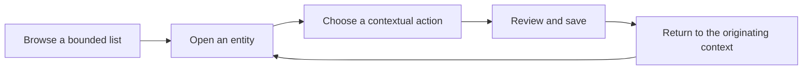

# Airbnb design research and a direction for Himmah

Research date: **29 October 2026**. Status: **research and proposed redesign direction; no application redesign implemented by this document**.

Airbnb makes a complex service feel approachable through clear information hierarchy, a coherent visual vocabulary, contextual actions and carefully staged decisions. Its more recent dimensional imagery adds personality to that foundation. For Himmah, the valuable goal is the same feeling of clarity, care and confidence, adapted to staff working with people, sessions and money.

This document covers principles, visual foundations, components, interactions, content, accessibility, responsive behavior, system governance and a practical redesign sequence. It is a comprehensive public-source study, not a copy of Airbnb’s private design-system specification.

## Reading guide

1. [Evidence and limits](#evidence-and-limits)
2. [How the design language evolved](#how-the-design-language-evolved)
3. [Principles and what they mean in practice](#principles-and-what-they-mean-in-practice)
4. [Visual language](#visual-language)
5. [Navigation and interaction language](#navigation-and-interaction-language)
6. [Component and state reference](#component-and-state-reference)
7. [Accessibility and internationalization](#accessibility-and-internationalization)
8. [Application to Himmah](#application-to-himmah)
9. [Proposed foundations for a prototype](#proposed-foundations-for-a-prototype)
10. [Redesign sequence and acceptance criteria](#redesign-sequence-and-acceptance-criteria)
11. [Source register](#source-register)

## Evidence and limits

Three labels distinguish the strength of a statement:

- **Published:** Airbnb, its design-system author or a directly involved design partner describes it. Historical guidance is explicitly dated.
- **Analysis:** our interpretation of the cited material. It is a design hypothesis, not an Airbnb policy or verified causal explanation of user satisfaction.
- **Proposal:** a recommendation for Himmah, subject to prototype review and testing. Numeric values in the proposed foundations are ours.

Research used Airbnb’s public design writing, current product-release pages, host-tool documentation, public website text and accessibility statement. The accessible 2016 and 2018 articles are published under Airbnb Design on Medium; their original airbnb.design URLs returned 404 during this research. The source register links to the versions actually read.

Official release pages link app stills and demos. These are useful references for subsequent visual review, but this pass did **not** complete authenticated native iOS/Android walkthroughs, measure screenshots pixel by pixel or inspect Airbnb’s private Figma library. Direct downloads from the media asset host were blocked by the execution environment. Image labels and descriptions supplied by the official pages were accessible; they do not establish exact radii, colors, shadow recipes or motion timing. This document does not claim those measurements.

Airbnb varies by platform, country, account, product and release. Its current public homepage text includes All, Homes, Hotels, Activities and Services [S7]; the 2025 launch material shows Homes, Experiences and Services [S4]. Neither should be treated as an immutable navigation specification. Exact native behavior and any account-specific variants remain a follow-up inspection task.

## How the design language evolved

| Period                     | Published evidence                                                                                                                                        | Implication for our research                                                                                          |
| -------------------------- | --------------------------------------------------------------------------------------------------------------------------------------------------------- | --------------------------------------------------------------------------------------------------------------------- |
| 2015–2016 DLS foundation   | A shared Design Language System addressed inconsistent features across teams and platforms; it standardized foundations and reusable components [S1, S2]. | Understand the system behind the appearance. A collection of attractive screens is insufficient.                      |
| 2016 interaction language  | Google’s contemporary case study describes typography, photography, bottom navigation and transitions connecting overview and detail [S3].                | Useful historical explanation; its Circular typeface and product screenshots are not current implementation guidance. |
| 2018 Cereal                | Airbnb introduced a custom typeface and tested it in realistic, text-heavy interfaces [S6].                                                               | Typeface selection must serve reading and hierarchy across the product, beyond the logo.                              |
| May 2025 rebuilt app       | Airbnb expanded into services and experiences and described a new dimensional, animated interface [S4, S5].                                               | The reference now includes richer expression alongside everyday utility.                                              |
| May 2026 product evolution | The release describes a new homepage and expanded planning tools; host reservation tools emphasize common tasks and contextual details [S8, S10].         | Include operational host workflows, which are especially relevant to Himmah.                                          |

**Analysis:** the persistent foundation is recognizable structure and understandable decisions. More expressive graphics can change while those qualities survive. A redesign based only on coral buttons or 3D icons would miss much of the system.

## Principles and what they mean in practice

Airbnb’s historical DLS names four principles: Unified, Universal, Iconic and Conversational [S1]. These are documented historical principles, not a claim that the current internal handbook is unchanged.

| Historical principle | Interpretation                                                              | Proposed Himmah decision rule                                                                                                                                     |
| -------------------- | --------------------------------------------------------------------------- | ----------------------------------------------------------------------------------------------------------------------------------------------------------------- |
| Unified              | A feature belongs to a larger product with shared behavior.                 | A contact action, session action and cash action should use the same menu, pending state and form conventions. Fix the shared pattern when several pages diverge. |
| Universal            | An interface should welcome people across languages, abilities and devices. | Design EN/NL/TR together; test large text, keyboard and screen readers; keep labels understandable without specialist knowledge.                                  |
| Iconic               | Focus makes a product distinctive and legible.                              | Keep Himmah’s forest identity and a clear main task; avoid adding badges, decorative panels or buttons without a reason.                                          |
| Conversational       | The interface communicates through language and feedback.                   | Explain the result of an action in plain language, confirm financial consequences, and show what happened without requiring interpretation.                       |

### Additional principles inferred from the product

The following are **analysis**, rather than additional official Airbnb principle names:

1. **Reduce uncertainty before commitment.** Details and consequences should be available before a consequential action. Airbnb’s upfront total-price policy and host reservation breakdowns support this reading [S10, S11].
2. **Organize around the moment of use.** Host Today tools emphasize current and upcoming work; reservation details bring communication and changes into context [S9, S10]. For Himmah, a volunteer running tonight’s session has different priorities from an administrator editing organizational settings.
3. **Use progressive disclosure.** Give the next decision enough information, with a clear route to the rest. This is our synthesis of the overview/detail and contextual task patterns, not evidence that every Airbnb screen follows one rigid rule.
4. **Let content establish hierarchy.** Typography and imagery can carry a page without enclosing every paragraph in a panel [S3]. For Himmah, people’s names, dates, status and amounts should do most of the work.
5. **Make warmth functional.** Friendly writing and responsive feedback should help someone continue. Warmth does not justify vague payment labels or a decorative delay.

## Visual language

### Typography

**Published:** Airbnb’s Cereal project balances brand character with legibility; its team tested letterforms, weights and realistic content in UI. The DLS uses named typographic styles shared by design and code [S6]. This is evidence about the system and its development, not a specification of every current size.

**Analysis:** the approachable feeling depends on a controlled hierarchy: prominent titles, readable body text, quieter metadata and deliberate emphasis. Weight, line length and the spacing around text matter as much as font family. The historical Google case study likewise emphasizes text and translation rather than relying exclusively on icons [S3].

**Proposal for Himmah:**

- Choose a properly licensed UI sans serif with good EN/NL/TR coverage; test names, currency and dates before choosing it. Cereal is a custom Airbnb typeface; this research supplies no license to use it.
- Define page title, section title, row title, body, supporting text and amount styles once. Avoid tuning each screen independently.
- Use moderate title tracking. Himmah currently applies a global 36px heading with -1.7px tracking in `src/styles/app.css`; assess that in long Dutch and Turkish titles rather than copying it into a new scale.
- Keep money and dates easy to compare; use tabular numerals where the selected font supports them. Do not make secondary information too faint to read.
- Let names wrap when identity matters. Use truncation only where a full name remains readily available.

### Color and contrast

**Analysis:** Airbnb’s recognizable accent coexists with quieter surfaces and strong text hierarchy. It is a mistake to turn every container into a brand-colored object. Public material does not give us a verified current native palette, so this document deliberately avoids publishing an “official” list of Airbnb hex values.

**Proposal:** retain Himmah’s forest green as its interaction accent, use restrained neutral surfaces, and separate brand color from semantic colors. Present, Paid, Warning and Error need distinct meanings even when some share a hue. Use text or an icon with status color. Give muted text a contrast requirement, not just an opacity setting.

Prototype a neutral paper surface against the current warm background. Choose the result based on readability, clarity of controls and the desired brand character. A full neutralization of Himmah’s identity is not already approved by this research request.

### Spacing and density

**Analysis:** useful whitespace expresses relationships. A larger gap signals a new section; smaller gaps bind a label to its value. Empty height inside a repetitive card has little value if it makes staff scroll further for the next person.

**Proposal:**

- Distinguish page gutters, section spacing, component padding and internal gaps. One token called “spacing” cannot describe all four.
- Apply page padding once. Align headings, search, rows and footers to that edge.
- Make directory rows compact and predictable. Let a session overview breathe more than a check-in roster.
- Use one padding owner inside a card. Remove duplicated Card plus CardContent padding rather than compensating with negative margins.
- Avoid fixed content heights for informational cards. Test one-line, multi-line and missing-data cases.
- Treat loading, empty and end-of-list areas as part of the density system. A short list does not need a large final spacer and a prominent end message.

This responds directly to the earlier Himmah issues with oversized contact actions, excessive card whitespace and inconsistent directory spacing.

### Shape, borders and elevation

**Published:** Airbnb explicitly describes the 2025 design as dimensional and animated [S5]. Its public descriptions do not specify exact corner radii or shadows.

**Analysis:** depth can communicate a layer, selection or object; applying it to every row weakens that meaning. A card, a text field, a pill filter and a sheet do not need identical corners just to look related.

**Proposal:** define a small radius family and a restrained elevation scale. Use divider-separated rows for repetitive data; bordered containers for grouped information; stronger elevation for overlays. Cards can be flat. Avoid a rounded panel inside another rounded panel when a heading and divider would suffice. Keep sticky action regions visually continuous with the page unless separation is necessary to distinguish an overlay.

### Icons, imagery and illustration

**Published:** the historical product study identifies photography as a major part of Airbnb’s voice; the 2025 release adds dimensional expression [S3, S5]. Their roles differ: listing imagery conveys the offering, while expressive visuals give product areas personality.

**Proposal:** keep Lucide for functional controls. Give an action icon a label or accessible name, and keep its touch target larger than its drawn shape. Define consistent sizes and stroke treatment. Use original Himmah illustrations sparingly for onboarding or a meaningful empty state, if they help explain the task.

Do not turn every contact into a decorative photo card or introduce an expectation of contact profile photography. Names and safe neutral avatars are sufficient. Youth privacy and missing photos are normal constraints. Any later activity imagery should be optional and genuine; the current operational redesign does not require new image-upload infrastructure.

### Motion and feedback

**Published:** the historical study explains transitions that connect overview and detail, and Airbnb’s Lottie project demonstrates design-to-runtime animation tooling [S3, S12]. Lottie’s existence does not prove which library the current Airbnb app uses or require us to adopt it.

**Proposal:** animate to explain cause and location: a sheet entering, an expanded section opening, a button acknowledging press, a status updating. Keep feedback quick enough for repeated check-in. Avoid animation loops in working rosters, celebratory cash effects, or delayed access to important content. Respect reduced motion; reduced animation must retain the same information and functionality. Prototype timing values appear below and are not measured Airbnb values.

## Navigation and interaction language

### Stable destinations, contextual work

**Published:** Airbnb documents separate host tools for Today, Calendar, Listings, Messages and Menu [S9]. Its current reservation redesign places common actions and important booking information together [S10]. Guest and host navigation serve different jobs.

**Proposal:** retain Himmah’s current product destinations and capability model while redesigning their presentation. Do not copy guest travel tabs into an operational application. A future Today entry could be useful, but would be a separately reviewed information-architecture change. Insights and learning remain subject to their actual implementation status; a visual redesign must not imply they have shipped.

Use a compact organization switcher, stable tab labels and a clear current destination. Secondary page links should describe their destination. A staff member should know which organization, activity and session an action affects.

### Overview → detail → action → return



This is a **proposed Himmah interaction grammar**, informed by the overview/detail relationship discussed in [S3]. It is not an Airbnb architecture diagram.

Rows and cards summarize enough to choose. Detail pages provide the full context. A short edit uses a sheet; a complex workflow gets a page. Saving returns to the originating filters and position where practical. Browser Back and direct links remain valid. Reopening a list should not reset staff to the top after every action.

### Primary and secondary actions

The existing Himmah rule remains a strong default: at most one prominent primary action per entity card. Use a small contextual control or the shared More menu for the rest. A navigation row can have no prominent button at all.

This is **our rule**, not a claim that Airbnb enforces a universal one-button limit. Decisions such as accept/decline and confirmation/cancel legitimately need paired choices; Airbnb’s host request documentation explicitly describes accept and decline [S10].

For Himmah, keep repeated check-in actions visible. Do not conceal every common action in a menu for visual minimalism. Lower-frequency actions, especially editing and history, fit the menu. Destructive choices need separation and explicit consequences.

### Forms, sheets and confirmation

Airbnb’s public accessibility material describes filter overlays with grouped options [S13]. That is evidence of one pattern, not an exact sheet specification or evidence that all simple Airbnb forms use bottom sheets.

Himmah already has a clear [form classification](../FORMS.md). Preserve it: short, focused forms use the shared sheet; complex forms use independently reloadable pages. Use a named heading, persistent labels, optional fields identified as such, helpful defaults, nearby errors and a deliberate save action. Preserve the owner’s no-autofocus requirement, keyboard navigation, focus trapping/restoration, draft guards and safe-area behavior.

The conceptual improvement is a sequence of understandable decisions. A large form does not become simple merely by putting it in a sheet or adding step numbers. Only introduce a wizard when steps have meaningful boundaries and users can review before commitment.

### Search, filters and lists

**Published:** Airbnb’s public homepage exposes destination, date and guest inputs [S7]. Host reservation documentation describes views and filtering around operational context [S9].

**Proposal:** give Himmah lists one clear search entry point, relevant filters and a visible active-filter state. Search labels should describe the subject where useful, such as “Search contacts.” Preserve URL-backed query/filter state and server pagination. Keep an accessible manual Load more control; do not make scrolling the only way to reveal records. Profile previews remain bounded with View all links and full-page lists; no nested infinite scroll inside overview cards.

## Component and state reference

The following is a **Himmah adaptation inventory**, not a reverse-engineered Airbnb component API. Use it to prevent the redesign becoming a series of unrelated page changes.

| Component or pattern     | Intended structure                                                      | Required behavior and states                                                                    |
| ------------------------ | ----------------------------------------------------------------------- | ----------------------------------------------------------------------------------------------- |
| App header               | Current organization, contextual identity, account utilities            | Long names, switcher open, no organization, scope loss; consistent safe-area edge               |
| Bottom navigation        | Stable destinations with text and icon                                  | Current location announced; readable labels; keyboard and screen-reader operation               |
| Page heading             | Title, optional concise explanation, page-level action                  | Wrapping titles; no forced empty subtitle slot; no autofocus                                    |
| Directory row            | Avatar/icon, name, one useful secondary line, optional trailing control | Full-row navigation without nested interactive links; long/missing fields; focus/pressed states |
| Activity/session summary | Identity, time, relevant policy/status, one primary route/action        | Free/paid, optional/required registration, cancelled/read-only; no redundant repeated title     |
| Information section      | Heading and related values; divider or restrained container             | No card inside card by default; variable content height; clear missing value                    |
| Button                   | Explicit verb, optional meaningful icon                                 | Default, hover, focus, pressed, pending, disabled; stable label and width when saving           |
| More menu                | Compact trigger, named actions, separated destructive item              | 44px target; keyboard selection; dismiss/focus restoration; permission-filtered actions         |
| Status                   | Short text with optional symbol/color                                   | Selected vs status distinguished; unknown vs absent; No charge yet vs Unpaid distinguished      |
| Field                    | Label, control, optional help, error                                    | Empty, filled, focused, invalid, disabled, read-only; errors programmatically linked            |
| Choice group             | Named question, clear options and current choice                        | Keyboard support; explanation where consequences differ; no color-only selection                |
| Picker                   | Search, bounded results, selection summary                              | Loading, no matches, unavailable record, stale version, next page; selected values retained     |
| Bottom sheet             | Named title, focused short task, action area                            | Keyboard-aware height; scrollable body; dismiss and unsaved rules; safe-area footer             |
| Page form                | Context/return link, grouped fields, review/save region                 | Direct loading; draft protection; uncertain save; return to original context                    |
| Confirmation             | Action consequence and specific final verb                              | One confirmation; cancel returns focus; pending cannot duplicate the mutation                   |
| Feedback                 | Inline error or action result at its source                             | Recoverable failure, conflict, permission loss and unknown outcome distinguished                |
| Skeleton                 | Approximation of the eventual layout                                    | No needless layout shift; loading announcement; no fake records or balances                     |
| Empty state              | What this means, then an authorized next step                           | First use, no search matches, no access and server failure have different content               |
| End/load-more            | Quiet completion or explicit pagination control                         | Reachable manually; no giant final blank block; new records announced appropriately             |
| Financial summary        | Fee, paid, outstanding and contextual actions                           | Zero is valid; no charge is separate; cancellation review and uncertain-save states explicit    |

Every component needs content rules as well as visual rules: which values are mandatory, what can be omitted, what wraps, which element owns padding, and what happens when actions are unavailable. Airbnb’s DLS author describes components in terms of required and optional elements and shared design/code definitions [S2].

## Content and trust

**Analysis:** beauty in an operational product includes knowing what will happen. Financial labels and permission states are part of the design language.

**Proposal:** write in a calm, direct voice. Use concrete verbs such as Add contact, Save session and Record cash. Avoid generic Continue when the action actually creates a debt. Show essential consequences before the action; move repeated background explanation into concise supporting help without hiding critical policy.

| Situation             | Preferred Himmah treatment                                | Avoid                                                              |
| --------------------- | --------------------------------------------------------- | ------------------------------------------------------------------ |
| Paid optional session | “Registration optional” and a separate session fee        | A label implying that paying reserves a place                      |
| Attendance saved      | Local present status plus available next action           | Automatically opening a payment form or implying payment occurred  |
| No charge             | “No charge yet” with session price if authorized          | “Unpaid” before a charge exists                                    |
| Cash submission       | Received, allocated, remaining balance and any new charge | A paid checkbox that hides accounting consequences                 |
| Lost response         | Explicit unknown outcome and exact retry                  | Claiming failure and inviting a fresh duplicate payment            |
| Unavailable edit      | Short explanation of the actual rule or lost permission   | An unexplained disabled button or a long repeated policy paragraph |
| No search results     | Query-aware message and Clear filters                     | A generic empty database message                                   |
| Cancelled session     | Clear status and permitted review actions                 | Deleting financial history to make the screen look clean           |

Airbnb’s 2025 total-price announcement establishes upfront costs as a published product choice, with tax treatment varying by region [S11]. Our adaptation is to make Himmah’s actual charge and cash consequences explicit; it does not imply Airbnb and Himmah share a payment model.

## Accessibility and internationalization

**Published:** Airbnb states that it strives toward WCAG 2.1 AA and documents screen-reader testing, font scaling, reduced-motion and manual loading options. It also discloses limitations, including gaps in tablet and some native keyboard/Braille testing [S13]. This is a statement of approach and limitations, not evidence that every screen conforms.

**Proposal for Himmah:** adopt WCAG 2.2 AA as the redesign target and verify it independently. Accessibility must be part of component acceptance, not inferred from visual resemblance to Airbnb.

- Maintain at least 4.5:1 contrast for ordinary text and 3:1 for qualifying large text; ensure necessary control boundaries and states meet applicable non-text contrast requirements [S14]. Check actual foreground/background combinations.
- Keep the existing 44px minimum interaction targets. This is our ergonomic target; it exceeds the WCAG 2.2 AA minimum target-size baseline in many circumstances, which also has exceptions [S14]. Small drawn icons can sit inside large targets.
- Support text zoom, reflow, visible focus, keyboard access, semantic headings, named controls and status announcements. Do not let a sticky footer hide the focused field.
- Test English, Dutch and Turkish with long names, localized plurals, € amounts, dates and Europe/Brussels time. Turkish İ/ı/Ğ/Ş must render correctly. Do not design only against short English labels.
- Use reduced-motion preferences; make gestures optional and provide buttons for equivalent actions. Preserve explicit dismissal and Save/Cancel.
- Test VoiceOver and TalkBack in the later prototype pass. This research has not performed those tests.
- Use CSS logical properties where practical. RTL is not currently a confirmed shipped locale requirement; prepare the foundations without implying complete Arabic support.

## Application to Himmah

### Current foundations to retain

The repository already supplies shared buttons/cards/menus, directory layouts, shadcn/Vaul sheets, complex-form routes, URL filters, skeletons, bounded profile previews, pagination, draft protection, cash permissions and immutable financial writes. These are useful foundations. A redesign should improve their presentation while preserving authorization and transactional behavior.

The visible baseline uses forest `#153f36`, warm paper `#f7f8f3`, lime `#def19e`, Arial/Helvetica fallbacks and a root 18px radius in `src/styles/app.css`. These are observed **Himmah** source values, not Airbnb tokens. Multiple style blocks and component-specific overrides mean a later audit must inspect computed styles; root variables alone do not describe every rendered screen.

### High-value screen translations

| Himmah surface        | Proposed design treatment                                                                                           | Preserve                                                                           |
| --------------------- | ------------------------------------------------------------------------------------------------------------------- | ---------------------------------------------------------------------------------- |
| My organizations      | Compact full-row identity and role, clear navigation affordance; creation as a separate page-level action           | Organization scope and accessible switching                                        |
| Contacts/groups/staff | Consistent header/search/filter rhythm and compact rows; names lead, metadata supports                              | Existing directory pattern, capabilities and full-row navigation                   |
| Contact profile       | Strong identity header followed by flat sections for contact details, groups and responsibilities                   | Relationship types, privacy, three-row previews and View all routes                |
| Activities            | Scannable activity identity and next relevant session; restrained status and one route forward                      | Free/paid defaults and audience semantics                                          |
| Session list          | Date/time first, concise operational status, one main action and More menu                                          | Original timezone, cancelled states, pricing and registration settings             |
| Session detail        | Identity/time at top, compact grouped facts; attendance primary, secondary operational links organized consistently | Separate attendance, registrations and cash capabilities                           |
| Attendance            | Dense, readable roster with immediate presence action; payment status subordinate and scope-aware                   | No inferred absence/debt/payment; scoped staff access                              |
| Cash and balances     | Amount hierarchy, readable contact rows, uncharged state distinct from debt, clear payment action                   | Partial allocations, exact retry, correction history and current permission checks |
| Simple forms          | Short, calm sheet with consistent field spacing and footer                                                          | No autofocus, draft protection and focus restoration                               |
| Complex forms         | Clear groups and reviewable consequences; long workflows on a page                                                  | Independent reload, safe return route, version checks and uncertain-save behavior  |

### What to adapt selectively

Do not import travel discovery mechanics indiscriminately. Photo carousels suit comparing stays; dense attendance needs quick vertical scanning. A map can be meaningful for a trip and irrelevant to a contact directory. Social proof and ratings are inappropriate substitutes for community-member identity or participation data. Three-dimensional category artwork can be attractive without helping a volunteer record thirty arrivals.

Similarly, a visually simplified interface must not merge registration, attendance and cash. Paid participation remains independent of required registration. An aesthetic redesign is not permission to add online payments, account linking, new social features or removed rewards/games.

## Proposed foundations for a prototype

**All numbers below are suggested Himmah starting values, not extracted Airbnb specifications and not approved production tokens.** Review them on real screens before adoption.

| Foundation         | Proposed starting range or rule                                                                        | Validation                                                                                |
| ------------------ | ------------------------------------------------------------------------------------------------------ | ----------------------------------------------------------------------------------------- |
| Spacing            | 4, 8, 12, 16, 24, 32, 48px steps                                                                       | Align related content; avoid arbitrary one-off compensations                              |
| Phone gutter       | 20px normally; 16px on very narrow screens                                                             | 320–430px phones, long labels and sheet edges                                             |
| Internal spacing   | 4–8px label/value; 12–16px grouped content; 24–32px between sections                                   | Compact rosters and information cards remain distinguishable                              |
| Typography         | Page 28–32px; section 20–24px; body/control 16px; supporting 14px                                      | Real EN/NL/TR text, zoom and font metrics; do not shrink critical money/error information |
| Text leading       | Body around 1.45–1.6; headings around 1.15–1.3                                                         | Wrapping, long names and text-heavy forms                                                 |
| Shape              | Controls 10–12px; bounded cards 16–20px; sheets 24px top corners; pills only for genuine pill controls | Distinct roles without arbitrary shape proliferation                                      |
| Controls           | 44px minimum touch target; main form controls around 48–52px tall                                      | Keyboard appearance, repeated actions, translated labels                                  |
| Elevation          | Flat base, subtle raised control, clearly separated overlay                                            | No shadow on every surface; overlay contrast tested                                       |
| Motion             | Press feedback around 100–150ms; small transitions 150–220ms; sheet around 220–300ms                   | Perceived response, reduced-motion alternative, no delay in repeated work                 |
| Desktop form width | Approximately 600–720px for reading/input; broader operational lists where useful                      | Do not stretch a phone card to the full desktop viewport                                  |
| Status palette     | Dedicated positive, warning, critical and neutral roles plus text                                      | Test against each surface; distinguish selected from paid/present                         |

Color selection should begin with Himmah’s existing identity and contrast tests. Do not assign Airbnb-like color values merely to make a token table look complete. Typeface selection and new illustration work remain open until comparative prototypes exist.

### System structure

Separate primitive values from semantic meaning and component use:

```text
Foundations: spacing, typography, neutral/brand/semantic colors, radii, elevation, motion
    ↓
Roles: page surface, raised surface, primary text, supporting text, primary action, error
    ↓
Components: button, row, field, menu, card, sheet, status, feedback
    ↓
Patterns: directory, entity detail, check-in, financial review, short edit, complex form
```

Use semantic tokens such as `surface-page`, `text-secondary` and `action-primary`. A payment state should not depend on a generic green token chosen for the logo. Give each shared component a documented default and a small number of named variants, with real examples and state coverage. Avoid global CSS overrides that silently restyle all links or all buttons.

Airbnb’s public DLS writing supports shared foundations and component definitions across design and code [S1, S2]. This specific token architecture is a **proposal for our repository**, not a claim about its current internal implementation.

## Redesign sequence and acceptance criteria

### 1. Establish a reference and baseline

Capture the current Himmah organization list, contacts, profile, session list/detail, attendance, cash, short sheet and complex page form with synthetic data. Include loading, empty, long-name, failure and permission states. Record actual computed type, spacing, shape and colors.

In a later permitted browser/device review, inspect Airbnb’s public/native overview, detail, filters, date selection, host reservation and settings flows. Record platform, app version, date, locale and authentication state alongside screenshots. Measure only what is actually visible and label it as a screen measurement rather than a universal Airbnb token. This closes the native-inspection gap in the current research.

### 2. Prototype one complete vertical slice

Use **session list → session detail → attendance → record cash → return**. It exercises dense rows, information hierarchy, one primary action, a short sheet, a complex page and financial feedback. Add a contacts/profile example to verify that the language also works outside activities.

Show coherent alternatives for typography, surface warmth and density. Agree the direction from complete flows before changing the entire application. A prototype can be reviewed with realistic synthetic long names and large lists; attractive empty screens are insufficient evidence.

### 3. Define and implement the shared system

Write tokens and component contracts after the prototype reveals actual needs. Update shared components first, then migrate the proven patterns across organizations, People, activities and Manage. Keep temporary compatibility rules bounded and remove obsolete overrides as each area migrates. Preserve all existing backend behavior unless an explicit functional change is separately agreed.

### 4. Validate the whole product

| Dimension                      | Acceptance evidence                                                                                                                                            |
| ------------------------------ | -------------------------------------------------------------------------------------------------------------------------------------------------------------- |
| Visual consistency             | Same heading/search/row/action rhythm across corresponding pages; explicit documented exceptions                                                               |
| Information hierarchy          | Names, dates, session state and amounts readable at a glance; limited repeated copy and no arbitrary empty card height                                         |
| Action hierarchy               | At most one prominent entity-card action; repeated essential work remains accessible without unnecessary menus                                                 |
| Forms                          | Existing page/sheet classification; no autofocus; correct keyboard-safe footers; one leave confirmation; successful return                                     |
| Large collections              | Bounded previews, server pagination, manual Load more, preserved filters and no nested profile scroll traps                                                    |
| Responsive behavior            | 320/390/430/768px and desktop review; long EN/NL/TR text; no horizontal overflow or obscured focused controls                                                  |
| Accessibility                  | Contrast, keyboard, reduced motion, screen readers, zoom/reflow and named controls tested independently                                                        |
| Financial and access integrity | Existing scope, stale-version, retry and atomicity tests continue passing; redesign cannot infer registrations or payments                                     |
| Performance                    | Stable skeletons and list layout; no decoration that delays check-in or enlarges every roster row                                                              |
| Task usability                 | Staff can find a contact, mark attendance, record partial cash, correct an entry and return without guidance; compare completion time/errors with the baseline |

Prototype review is the logical next step after this research. A new navigation destination, custom font, image feature or motion library requires an actual design/technical decision; none is automatically adopted here.

## Source register

All sources below were accessed through web research on 29 October 2026. Dates describe publication where available. Summaries and recommendations are independently written; original assets remain with their owners. Reference media is linked rather than redistributed in the application.

| ID  | Source                                                                                                                                                                                               | What it supports and its limits                                                                                                                                    |
| --- | ---------------------------------------------------------------------------------------------------------------------------------------------------------------------------------------------------- | ------------------------------------------------------------------------------------------------------------------------------------------------------------------ |
| S1  | [Building a Visual Language — Airbnb Design / Karri Saarinen](https://medium.com/airbnb-design/building-a-visual-language-behind-the-scenes-of-our-airbnb-design-system-224748775e4e), 6 August 2016 | Historical DLS origins, four principles, foundations and component approach. Not a current token specification.                                                    |
| S2  | [Airbnb Design Language System — Karri Saarinen](https://karrisaarinen.com/dls/)                                                                                                                     | First-person account of required/optional component elements, cross-platform conventions and responsive reuse. Historical project account.                         |
| S3  | [Airbnb: Communicating Clarity and Charm — Google Design](https://design.google/library/airbnb-invites-you-in)                                                                                       | Contemporary case study of the 2016 product, with direct designer explanations of type, navigation, imagery and motion. Not evidence of current Circular usage.    |
| S4  | [Airbnb 2025 Summer Release — official product page](https://news.airbnb.com/product-releases/airbnb-2025-summer-release), 13 May 2025                                                               | Official app screen descriptions, overview of Explore/Trips/Messages/Profile and linked product media. Marketing representations, not measured native screenshots. |
| S5  | [2025 Summer Release announcement — Airbnb](https://news.airbnb.com/en-uk/2025-summer-release-now-you-can-airbnb-more-than-an-airbnb), 13 May 2025                                                   | Rebuilt app, host tools and stated dimensional/animated design direction.                                                                                          |
| S6  | [Working Type — Airbnb Design / Karri Saarinen](https://medium.com/airbnb-design/working-type-81294544608b), 18 December 2018                                                                        | Cereal, realistic UI type testing and named typography styles. Historical process, not a license or current full type scale.                                       |
| S7  | [Airbnb public homepage](https://www.airbnb.com/)                                                                                                                                                    | Current accessible text for product categories and Where/When/Who search. Locale/variant dependent; JavaScript content incomplete in text retrieval.               |
| S8  | [Airbnb 2026 Summer Release — official product page](https://news.airbnb.com/product-releases/airbnb-2026-summer-release), 20 May 2026                                                               | Continued homepage, planning and product expansion; linked official media. Does not establish availability of every announced feature to every user.               |
| S9  | [Exploring your hosting tools — Airbnb Resource Center](https://www.airbnb.com/resources/hosting-homes/a/exploring-your-hosting-tools-738), 10 December 2025                                         | Host destination structure and current/upcoming work. Article itself warns information may change.                                                                 |
| S10 | [Reservations, redesigned — Airbnb Resource Center](https://www.airbnb.com/resources/hosting-homes/a/reservations-redesigned-765), 20 May 2026                                                       | Contextual host actions, request decisions, reservation details and earnings breakdown.                                                                            |
| S11 | [Total price display is now standard for guests worldwide — Airbnb](https://news.airbnb.com/total-price-display-is-now-standard-globally), 21 April 2025                                             | Upfront total-price policy and regional tax qualifications. Not a model for Himmah’s ledger.                                                                       |
| S12 | [Lottie — Airbnb Engineering](https://airbnb.tech/opensource/lottie/)                                                                                                                                | Public animation tooling and design/engineering connection; not proof of the current app’s animation stack.                                                        |
| S13 | [Accessibility at Airbnb](https://www.airbnb.com/accessibility/) and [Accessibility Statement](https://www.airbnb.com/help/article/3928)                                                             | Stated standards, assistive technology, reduced motion, loading controls and disclosed testing limits. Neither proves complete conformance.                        |
| S14 | [WCAG 2.2 — W3C Recommendation](https://www.w3.org/TR/WCAG22/)                                                                                                                                       | Independent acceptance standard for contrast, reflow, focus, target size and other accessibility requirements; not an Airbnb-specific design rule.                 |

### Official visual reference links for the prototype pass

These references were discovered in the official 2025 release page. This research read their official descriptions; it does not claim pixel inspection of these files.

- [Explore / all-new app still](https://news-assets.withairbnb.com/wp-content/uploads/sites/21/2025/05/All-new-app-US.jpg): review navigation hierarchy and category expression.
- [Trips still](https://news-assets.withairbnb.com/wp-content/uploads/sites/21/2025/05/Trips-tab-US.jpg): review scheduling and itinerary composition.
- [Profile still](https://news-assets.withairbnb.com/wp-content/uploads/sites/21/2025/05/Guest-profile-US.jpg): review identity and summary hierarchy.
- [Host tools still](https://news-assets.withairbnb.com/wp-content/uploads/sites/21/2025/05/Host-tools-Summer-Release-2025-US.jpg): review operational hierarchy as a closer analogue for Himmah.
- [2026 release page and media](https://news.airbnb.com/product-releases/airbnb-2026-summer-release): compare the later homepage and hotel overview/detail flow before adopting an older visual reference as current.
