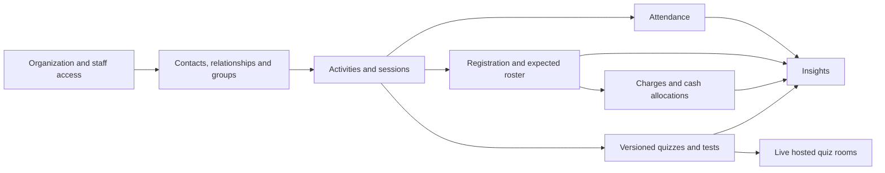

# Himmah redesign — 28 October 2026

Current release: [complete dropped-feature removal and app integration](../REMOVAL.md) supersedes earlier statements below about retained legacy products, standalone People navigation and the previous schema lineage.

Current continuation: [Who to contact and authorized hosted rollout](COMMUNICATION_STATUS.md) supersedes the earlier local-only status below.

Status: contacts, groups, relationships and Who to contact are implemented. The owner authorized committing, pushing and hosted rollout; see [current implementation and rollout](COMMUNICATION_STATUS.md) and [verification record](../INFRASTRUCTURE.md). The new schema has been installed additively on verified Himmah development/onboarding; no reset or legacy contact migration occurred.

The [owner brief](OWNER_BRIEF.md) is the verbatim revised request and supersedes conflicting older product scope. Recommendations below are not owner approvals. Existing source describes the old implementation, not the target product.

Read in order:

1. [Product specification and decisions](PRODUCT.md)
2. [Workflow map and permissions](WORKFLOWS.md)
3. [Proposed domain and data model](MODEL.md)
4. [Repository audit](AUDIT.md)
5. [Phased rebuild and reset runbook](PLAN.md)
6. [Concrete contacts, relationships and groups implementation design](PEOPLE_IMPLEMENTATION.md)
7. [Groups and relationships implementation status](GROUPS_RELATIONSHIPS_STATUS.md)

## Design research

[Airbnb design language research and proposed Himmah redesign direction](AIRBNB_DESIGN_RESEARCH.md) — researched 29 October 2026. Covers public principles, visual and interaction language, component states, accessibility and a proposed prototype sequence. The owner subsequently authorized the redesign and adopted the [Himmah design system](../DESIGN_SYSTEM.md) as a standing preference for all existing and future UI work. The research remains the historical source; the design system records implementation choices.

## Foundation map

Arrows show context/data use, not mandatory workflow gates: attendance permits walk-ins without prior registration; cash does not require attendance; learning can run without attendance restrictions. Family ties and temporary learner identities confer no staff access.

## Decision history

- Before 28 October: Hub centered on engagement awards and a connected Futsal game; participant account linking, rewards and challenges were built. Preserve that work in Git, without making it a rebuild obligation.
- 28 October, owner-confirmed: contact management, relationships, groups, activities, sessions, registration, attendance and operational cash form the core. Insights follow; learning is the first fundamental extension, followed by hosted live quizzes. No age restriction. Staff authentication remains required; permanent contact accounts are deferred.
- 28 October, owner-confirmed: all existing data is disposable; no migration or backward compatibility required. Only Himmah may be reset, after target verification and a reviewed design. No reset is authorized in this documentation pass.
- 28 October, recommended: modular monolith, session-level charges initially, effective-dated group membership and frozen expected rosters, scoped staff capabilities, append-only cash corrections, immutable assessment publication versions. These remain proposals.

## Review decisions

| Decision | Recommended default | Tradeoff / remaining choice |
| --- | --- | --- |
| Charge scope — owner-confirmed | Free by default; optionally paid activity with session override; per-session charges initially | Only paid registrations create charges. Whole-program fees deferred. |
| Expected audience — selected under owner delegation | Registered sessions use confirmed registrations; open sessions have no denominator unless staff selects a roster. Freeze at check-in opening; audit amendments. | Stable history; no automatic absence or audience-to-expected inference. |
| Staff privileges — selected under owner delegation | Owner/admin/volunteer presets; separate scoped check-in and collection grants; refunds/waivers admin only | Minimal volunteer data access; detailed rules in WORKFLOWS. |
| Anonymous learning | Expiring organizer-issued attempt credentials; optional verified contact binding | Works without accounts; invitations/links must be protected against sharing. |
| Live identity | Host approval, private participant token, optional staff-confirmed contact link | Additional host step; nickname alone never yields a verified contact score. |
| Privacy/retention | Minimum contact fields, no public attendance/results; restricted emergency/guardian data | Organization must define retention, guardian verification evidence and consent practices before pilot. |
| Live transport | Evaluate Cloudflare Durable Object per room, PostgreSQL durable checkpoints | Fits hosting and authoritative room ordering; validate cost, throughput and recovery before adopting. |

Currency, refund authority, registration cancellation fees, attendance correction window, late check-in opening, supported recurrence patterns, assessment pass/retry defaults, live speed bonus/accessibility settings, and retention periods remain configurable policy decisions. Proposals in linked documents let implementation planning proceed; they are not finalized schema commitments.

## Owner clarification — optional paid activities

Confirmed in follow-up on 28 October 2026: activities are free by default and may optionally be marked paid with a default price. Sessions inherit free/paid status and price, with explicit overrides (for example, a free introductory session). Initially charge per registered contact per paid session; whole-program fees are deferred. Registration saves the amount owed, so later price changes cannot silently alter existing charges. Free registrations have no charge or cash workflow. Attendance and payment remain independent, displayed together for paid sessions. Other recommendations in this package remain proposals unless separately confirmed.

## Delegated foundation defaults — 28 October 2026

Owner authorized choosing logical starting permissions and expected-attendance rules without further routine confirmation. The selected defaults are documented in [workflows and permissions](WORKFLOWS.md): owner/admin/volunteer presets, separate scoped check-in/cash grants, administrator-only refunds/waivers/directory changes, explicit expected rosters, check-in opening 30 minutes before start, and volunteer corrections through 24 hours after end. These are agent-selected starting policies under owner delegation, not claims that the owner individually specified every detail. This delegation does not authorize database reset, rebuilding or deployment during the current documentation task.
